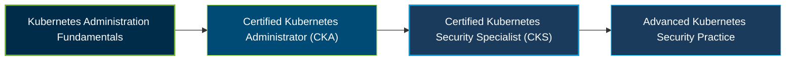

# Certified Kubernetes Security Specialist (CKS) Certification Exam Guide

[](https://training.linuxfoundation.org/certification/certified-kubernetes-security-specialist/)
[](https://training.linuxfoundation.org/certification/certified-kubernetes-security-specialist/)

A dedicated study guide and security reference repository for candidates preparing for the **Certified Kubernetes Security Specialist (CKS) Certification Exam**, covering Kubernetes cluster hardening, workload security, supply chain protection, and runtime threat detection.

---

## Exam Overview

The Certified Kubernetes Security Specialist (CKS) certification validates practical skills in securing Kubernetes clusters and containerized applications throughout build, deployment, and runtime.

- **Exam Format**: Online, proctored, performance-based exam using a Kubernetes command-line environment.
- **Target Audience**: Kubernetes Administrators, Cloud Security Engineers, DevOps Professionals, and Site Reliability Engineers.
- **Prerequisites**: Candidates must have passed the Certified Kubernetes Administrator (CKA) exam before attempting CKS. The CKA certification does not need to remain active.

---

## Core Exam Domains & Knowledge Areas

### 1. Cluster Setup

- Configure network security policies and secure Kubernetes cluster components.
- Apply CIS benchmark recommendations and configure Ingress with TLS.
- Protect node metadata and verify platform binaries before deployment.

### 2. Cluster Hardening

- Apply role-based access control (RBAC) and least-privilege permissions.
- Restrict Kubernetes API access and manage ServiceAccounts securely.
- Keep Kubernetes components updated to reduce known vulnerabilities.

### 3. System Hardening

- Reduce the host operating system's attack surface.
- Apply least-privilege identity and access management.
- Use kernel security mechanisms such as AppArmor and seccomp.

### 4. Minimize Microservice Vulnerabilities

- Apply Pod Security Standards and manage Kubernetes Secrets securely.
- Use isolation techniques for workloads and multi-tenant environments.
- Understand Pod-to-Pod encryption and service-mesh security concepts.

### 5. Supply Chain Security

- Minimize container image size and reduce unnecessary components.
- Understand software bills of materials (SBOMs), CI/CD pipelines, and artifact repositories.
- Validate images, restrict trusted registries, and use image scanning and signing tools.

### 6. Monitoring, Logging and Runtime Security

- Detect suspicious behavior across workloads, networks, and infrastructure.
- Investigate security incidents and identify potential attack activity.
- Use immutable container practices and Kubernetes audit logs for monitoring.

---

## Certification Path

The following diagram presents a suggested learning progression. Passing CKA is the official prerequisite for attempting CKS; the later security practice step is a recommendation, not an official successor certification.



---

## Recommended Practice & Study Resources

Combine official learning materials, security-focused practice, and hands-on Kubernetes labs to strengthen your understanding of cluster and workload protection.

- **Official Linux Foundation Resources**: Review the [CKS certification page](https://training.linuxfoundation.org/certification/certified-kubernetes-security-specialist/), official exam curriculum, and Kubernetes Security Essentials training.
- **CertsGate**: Explore [CKS certification preparation resources](https://certsgate.com/exams/linux-foundation/cks) for supplementary study and practice materials.
- **Practical Security Resources**: Use the [Kubernetes Security documentation](https://kubernetes.io/docs/concepts/security/), [CIS Kubernetes Benchmark](https://www.cisecurity.org/benchmark/kubernetes), and [Kubernetes documentation](https://kubernetes.io/docs/) to practice security controls, RBAC, Pod hardening, audit logging, and workload protection.
```
